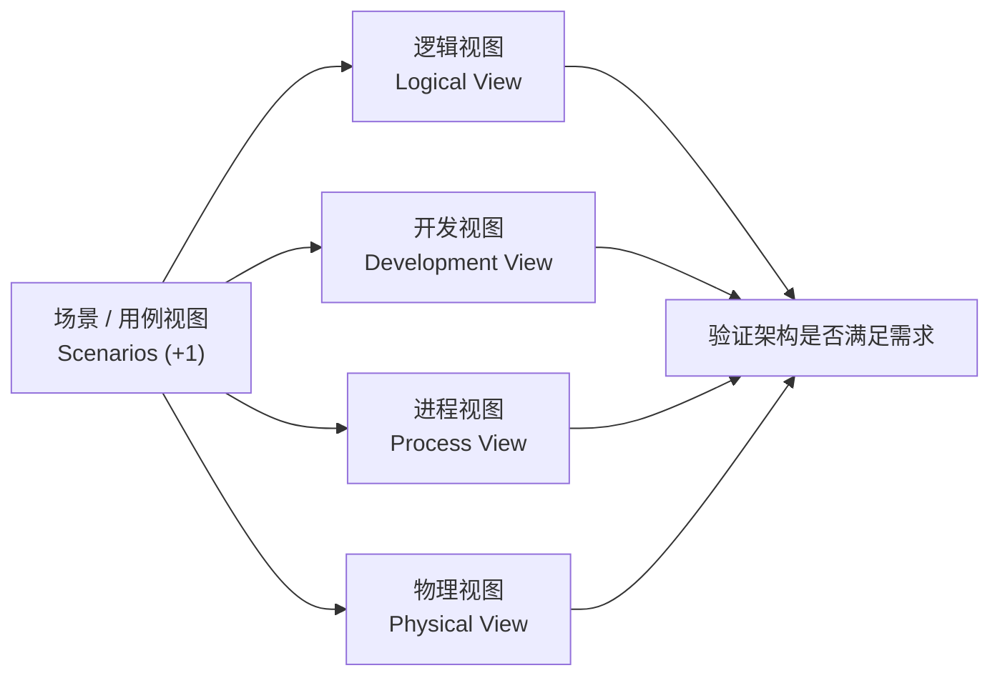
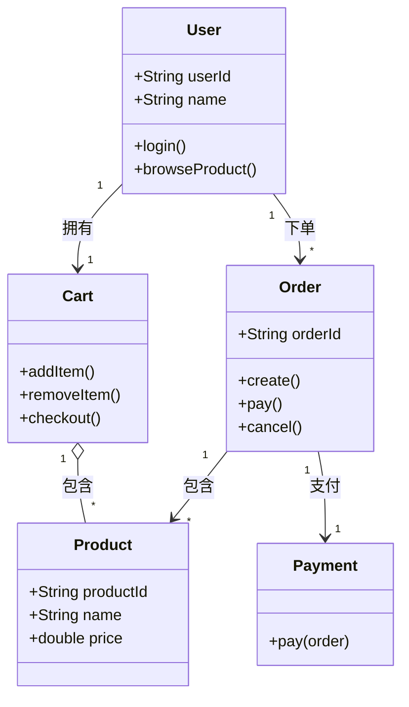
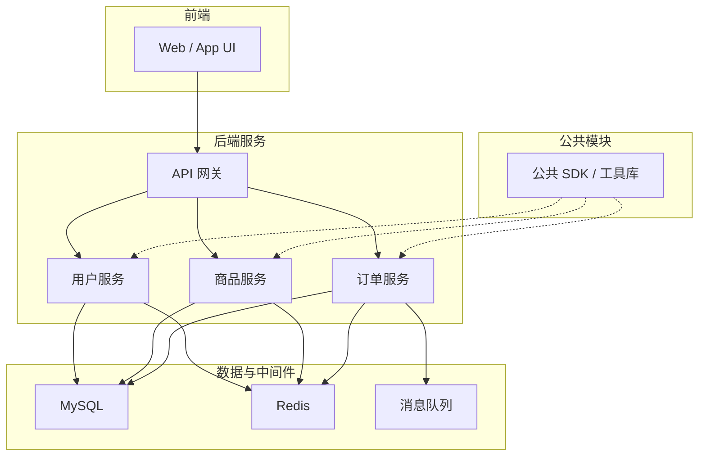
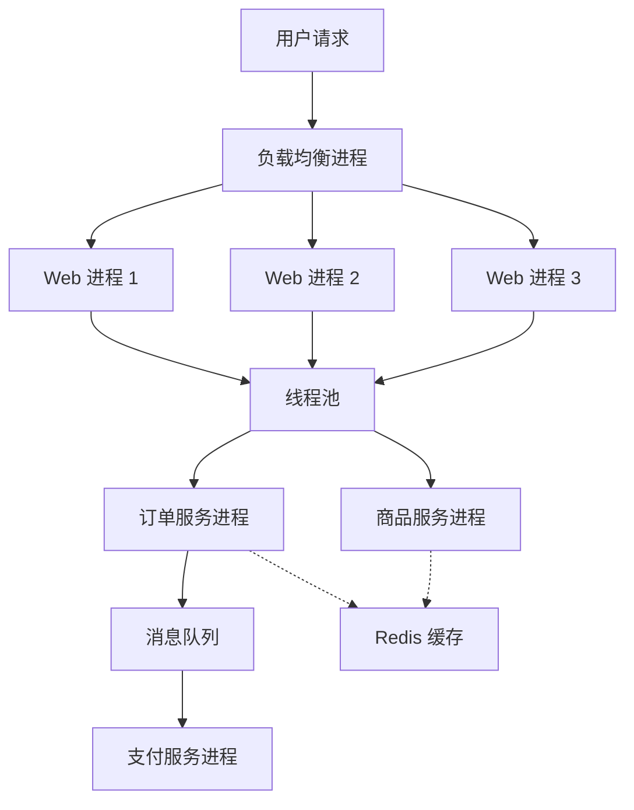
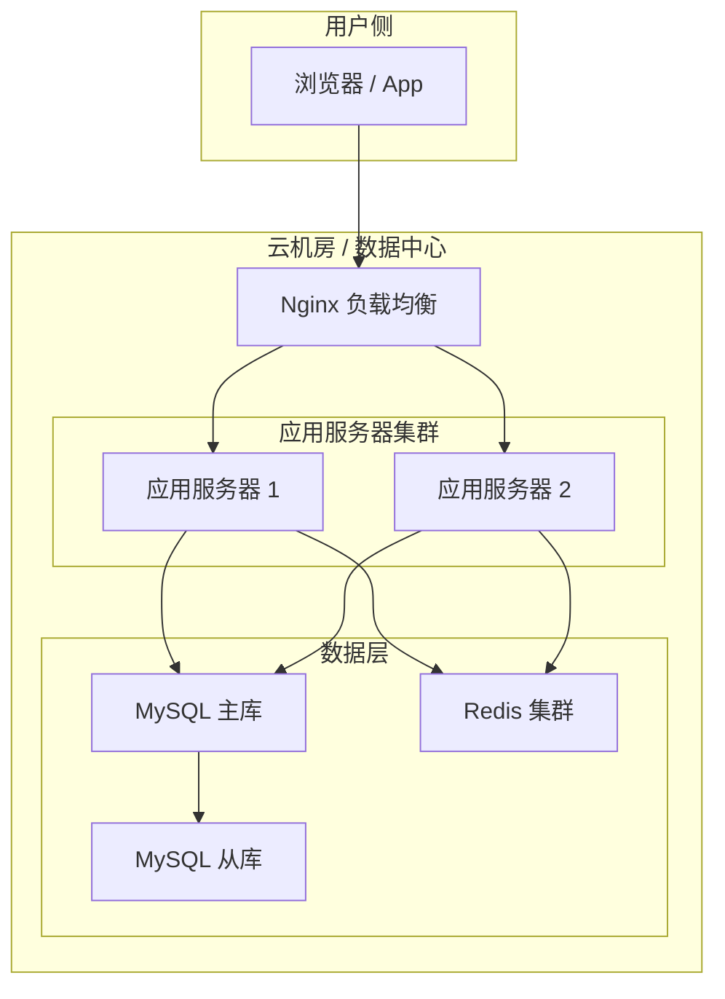
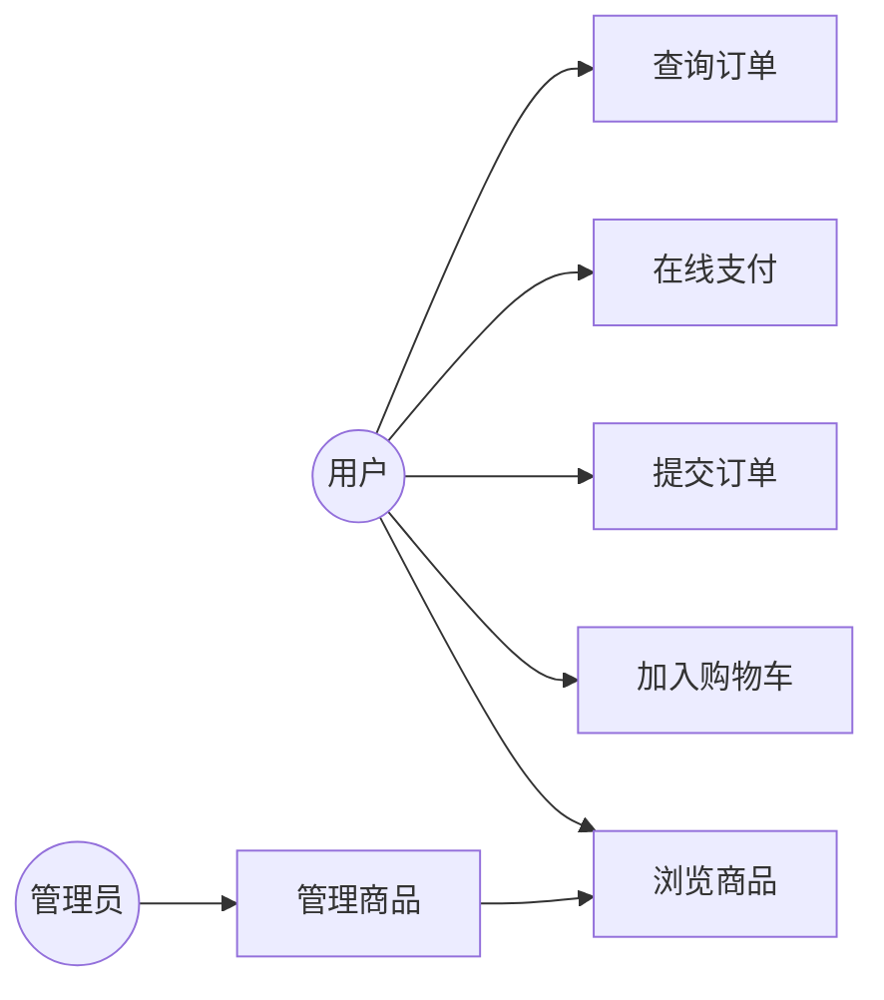
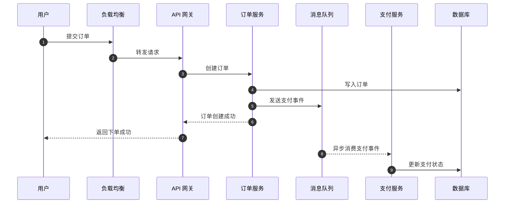
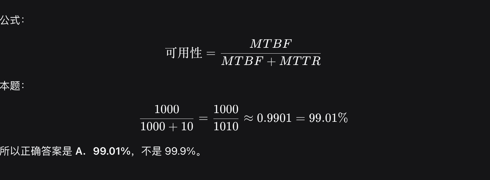
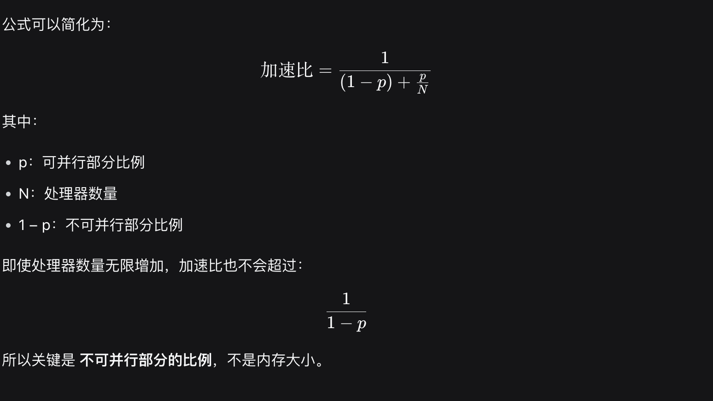

# 系统架构设计师：4+1 视图模型图解

> 示例系统：在线购物系统  
> 用途：软考系统架构设计师 · 综合知识复习  
> 图示说明：文中使用 Mermaid 语法，可在 Typora、Obsidian、VS Code、飞书文档、语雀等支持 Mermaid 的编辑器中渲染为图片；也可复制到 [Mermaid Live Editor](https://mermaid.live) 查看。

---

## 目录

**开(发)罗(辑)勿(理)进(程)**

1. 逻辑视图 Logical View
2. 开发视图 Development View
3. 进程视图 Process View
4. 物理视图 Physical View
5. 场景 / 用例视图 Scenarios / Use Case View
6. 4+1 视图速查表

---

## 0. 4+1 视图关系总览

**说明：**  
4+1 视图模型由 Kruchten 提出，包括 4 个基本视图和 1 个场景/用例视图。场景视图用于验证其他四个视图是否能够协同满足系统需求。

---

## 1. 逻辑视图 Logical View

### 关注点

- 系统功能需求
- 类与对象
- 职责划分
- 对象之间的关系

### 图示

### 图意

用户拥有购物车，购物车包含商品；用户可创建订单，订单包含商品并关联支付。  
逻辑视图主要回答：**系统有哪些功能、有哪些核心对象、对象之间是什么关系。**

---

## 2. 开发视图 Development View

### 关注点

- 模块划分
- 包与组件
- 层次结构
- 静态依赖关系

### 图示

### 图意

前端通过 API 网关访问后端服务；后端服务按业务拆分，并依赖数据库、缓存、消息队列和公共模块。  
开发视图主要回答：**代码和模块如何组织、谁依赖谁。**

---

## 3. 进程视图 Process View

### 关注点

- 并发
- 同步
- 性能
- 吞吐量
- 进程 / 线程协作

### 图示

### 图意

请求经负载均衡分发到多个 Web 进程，再通过线程池并发处理；订单、支付等通过消息队列异步协作。  
进程视图主要回答：**系统运行时如何并发、如何同步、如何保证性能和吞吐量。**

---

## 4. 物理视图 Physical View

### 关注点

- 软件到硬件节点的映射
- 系统部署结构
- 服务器、数据库、缓存等物理分布

### 图示

### 图意

用户访问负载均衡器，请求进入应用服务器集群；应用服务器访问 MySQL 主库和 Redis，MySQL 主从复制。  
物理视图主要回答：**软件部署到哪些硬件节点、节点之间如何连接。**

---

## 5. 场景 / 用例视图 Scenarios / Use Case View

### 关注点

- 通过关键业务场景验证架构
- 检查其他视图是否满足需求
- 发现架构中的风险和不足

### 5.1 用例图

### 5.2 关键场景：下单支付时序图

### 图意

下单主流程同步完成，支付流程通过消息队列异步解耦，避免用户长时间等待，同时提升系统吞吐量。  
场景视图主要回答：**这套架构能否通过关键业务场景验证。**

---

## 6. 4+1 视图速查表

| 视图 | 关注点 | 核心问题 |
|---|---|---|
| 逻辑视图 | 功能需求、类和对象 | 系统有哪些功能、对象和关系？ |
| 开发视图 | 模块、包、静态组织 | 代码和模块如何组织？ |
| 进程视图 | 并发、同步、性能、吞吐量 | 系统运行时如何并发与协作？ |
| 物理视图 | 软件到硬件映射、部署 | 软件部署到哪些节点？ |
| 场景/用例视图 | 场景验证 | 架构能否通过关键业务场景验证？ |

记住：
**逻类，开模，进并，物部署，例功**

**功能** → 用例图
**结构** → 类图
**交互顺序** → 时序图
**部署** → 部署图
**状态变化** → 状态图

---

**IaaS**：提供虚拟机、存储、网络等基础资源. 给你“地基”
**PaaS**：提供操作系统、中间件、数据库等平台，用户仍需部署和管理自己的应用. 给你“平台”，你部署应用
**SaaS**：提供可直接使用的软件，用户无需管理基础设施、平台和应用.  给你“现成软件”，直接用
**DaaS**：数据即服务

结构|	含义|	可靠性公式
-|-|-
**串联**|	所有组件都正常，系统才正常|	R = R₁ × R₂ × … × Rₙ
**并联**|	至少一个组件正常，系统就正常|	R = 1 − (1−R₁)(1−R₂)…(1−Rₙ)

两个都失效的概率 = 0.1 × 0.1 = 0.01
系统可靠性 = 1 − 0.01 = 0.99

**数字签名**主要用于保证：

- **完整性**
- **身份认证**
- **不可抵赖性**

OSI 七层模型自下而上：

层次|	主要功能|	典型协议/设备
-|-|-
7 应用层|	为用户提供网络应用服务|	HTTP、FTP、SMTP、DNS
6 表示层|	数据格式、加密、压缩|	JPEG、ASCII、SSL/TLS 的部分功能
5 会话层|	建立、管理和终止会话|	RPC、会话管理
4 传输层|	端到端可靠传输、流量控制、差错恢复|	TCP、UDP
3 网络层|	IP 寻址、路由选择、分组转发|	IP、ICMP、OSPF
2 数据链路层|	MAC 地址、成帧、差错检测|	Ethernet、交换机
1 物理层|	传输比特流|	网线、中继器、集线器

测试阶段区分：

- **单元测试**：测试单个模块、函数或类
- **集成测试**：测试模块之间的接口和协作
- **系统测试**：测试整个系统是否满足需求规格说明书
- **验收测试**：由用户或客户确认系统是否满足业务需求

**功能需求**：系统“做什么”，如登录、下单、支付
**非功能需求**：系统“做得怎么样”，如性能、安全性、可靠性、可用性

**领域驱动设计**中的核心概念：

概念|	含义
-|-
实体 Entity|	有唯一标识，生命周期中属性可变
值对象 Value Object|	没有唯一标识，通常不可变
聚合 Aggregate|	一组具有一致生命周期的实体和值对象的集合
聚合根 Aggregate Root|	聚合的入口，外部只能通过它访问聚合内部对象
限界上下文 Bounded Context|	领域模型的边界，在边界内统一语言和模型保持一致

**Lambda 架构**通常包括：批全，速增，服外

- **批处理层 Batch Layer**：处理全量历史数据，保证准确性
- **速度层 Speed Layer**：处理实时增量数据，保证低延迟
- **服务层 Serving Layer**：对外提供查询结果

**可用性计算**

可用性=  MTBF/MTBF+MTTR

## 机器学习主要类型

类型|	数据特点|	典型任务
-|-|-
监督学习|	有标签数据|	分类、回归
无监督学习|	无标签数据|	聚类、降维、关联规则
强化学习|	智能体与环境交互，根据奖励学习策略|	游戏 AI、机器人控制
迁移学习|	把已有任务的知识迁移到新任务|	预训练模型微调

### 数据仓库

数据仓库**星型模型**通常由：

**事实表**：存放业务度量值和关联维度表的外键，如销售额、数量
**维度表**：描述分析维度，如时间、地区、产品、客户

**星型模型**是数据仓库中常用的建模方式，主要用于：

- **OLAP**
- **多维分析**
- **决策支持**
- **BI 报表**

**OLTP vs OLAP**

对比项|	OLTP|	OLAP
-|-|-
全称|	联机事务处理|	联机分析处理
面向|	日常业务交易|	分析、决策支持
操作特点|	高并发、短事务、实时性强|	复杂查询、多维聚合、批量分析
典型系统|	银行存取款、订单系统|	数据仓库、BI 报表、经营分析

一句话：**OLTP 回答“刚刚发生了什么”，OLAP 回答“这些数据意味着什么”**。

类型|	运行位置|	特点
-|-|-
Type 1| 裸金属虚拟化|	直接运行在物理硬件上	性能好，常用于服务器虚拟化
Type 2| 宿主型虚拟化|	运行在宿主操作系统之上	常用于桌面虚拟机软件

## HTTP 幂等性
幂等的含义：

    对同一个接口发起多次相同请求，所产生的最终效果与发起一次请求相同。

常见 HTTP 方法：

方法|	是否幂等|	说明
-|-|-
GET|	是|	查询操作，多次请求结果通常相同
PUT|	是|	更新为同一资源状态，多次执行效果一致
DELETE|	是|	删除同一个资源，多次执行最终都是删除
POST|	否|	通常用于新增资源，多次提交可能创建多条记录
PATCH|	通常不保证|	取决于具体实现

## Amdahl 定律

定律说明: `系统加速比的上限，主要受不可并行部分的比例限制。`

## 各类架构方法核心对比

方法|	英文全称 / 缩写|	核心强调|	一句话记忆
-|-|-|-
ABSD|	Architecture-Based Software Design|	以架构为中心，质量属性驱动，递归细化，评估演化|	架构驱动整个开发过程
ADD|	Attribute-Driven Design|	从质量属性场景出发，递归分解功能和质量属性|	属性驱动设计
DSSA|	Domain-Specific Software Architecture|	面向特定领域，提炼共性与可变性，形成参考架构和可复用资产|	领域特定架构
SAAM|	Software Architecture Analysis Method|	基于场景评估架构，最初关注可修改性|	场景驱动的早期架构评估
ATAM|	Architecture Tradeoff Analysis Method|	分析多个质量属性之间的权衡，识别敏感点、权衡点、风险和非风险|	质量属性权衡分析
CBAM|	Cost Benefit Analysis Method|	从成本、收益、投资回报角度评估架构决策|	架构决策的经济分析
4+1 视图模型|	4+1 View Model|	用逻辑、开发、进程、物理和场景视图描述架构|	多视图描述架构
SPL|	Software Product Line|	通过核心资产库和可变性管理，派生多个产品|	核心资产复用
TOGAF ADM|	Architecture Development Method|	企业架构开发的迭代方法，覆盖架构开发全生命周期|	企业级架构开发方法
DDD|	Domain-Driven Design|	以领域模型为核心，划分限界上下文，统一语言|	业务领域驱动设计
CBSE|	Component-Based Software Engineering|	以构件为单位进行复用、组装和替换|	构件复用与组装
ADL| Architecture Description Language|用于描述软件架构中的 构件、连接件和配置

*ADD / ABSD 是设计方法；SAAM / ATAM / CBAM 是评估方法。*

### 5G 三大应用场景

场景|	英文全称|	核心特点
--|--|--
eMBB|	enhanced Mobile Broadband|	高速移动宽带
URLLC|	Ultra-Reliable Low-Latency Communication|	低时延、高可靠
mMTC|	massive Machine-Type Communication|	海量机器类通信

### 设计模式

**行为型设计模式**

模式|	核心作用
--|--
外观模式 Facade|	为子系统提供统一的高层接口，简化使用
适配器模式 Adapter|	将一个类的接口转换成客户期望的另一个接口
代理模式 Proxy|	控制对对象的访问
装饰器模式 Decorator|	动态给对象添加职责
策略模式 Strategy|	定义算法族，使它们可以相互替换
桥接 Bridge|	将抽象部分与实现部分分离，使二者可独立变化
组合 Composite|	树形结构表示“部分-整体”层次
享元 Flyweight|	共享细粒度对象，减少内存占用
命令模式| 把请求封装成对象，支持参数化、排队、记录日志、撤销。
责任链模式| 多个对象都有机会处理请求，形成一条处理链。
观察者模式|一对多通知，不是请求沿链传递。
模板方法模式| 定义算法骨架，把某些步骤延迟到子类实现。
命令模式| 封装请求，不强调算法骨架。

浓缩成一句口诀：
**适配转接口，策略相互转，桥接分两层，组合成树形，装饰加功能，享元省内存，外观做总控，代理控访问**。

最容易混淆的三个可以这样区分：
- **适配器**：解决“接口对不上”。
- **装饰器**：解决“想动态加能力”。
- **代理**：解决“想控制访问”。

**创建型模式**

| 模式 | 核心作用 | 一句话记忆 |
|---|---|---|
| 单例模式 | 保证一个类只有一个实例 | 全局唯一 |
| 工厂方法模式 | 由子类决定创建哪个具体对象 | 子类决定创建 |
| 抽象工厂模式 | 创建一族相关或依赖的对象 | 成套创建 |
| 建造者模式 | 分步骤构建复杂对象 | 分步拼装 |
| 原型模式 | 通过复制已有对象生成新对象 | 复制克隆 |

### SOAP 和 REST / GraphQL 的简单对比

维度|	SOAP|	REST|	GraphQL
--|--|--|--
本质|	协议|	架构风格|	查询语言/运行时
数据格式|	XML|	通常 JSON|	通常 JSON
安全|	WS-Security、消息级安全|	HTTPS + OAuth/JWT|	依赖网关/应用层
事务|	支持 ACID、可靠消息|	需应用层实现|	不内置事务
适用场景|	企业集成、金融、遗留系统|	公开 API、微服务|	前端灵活取数、多端聚合

一句话选法：需要“严格契约 + 消息级安全 + 事务一致性”时选 SOAP；
需要“轻量、缓存、易扩展”时选 REST；
需要“前端按需取字段、一次请求拿多层数据”时选 GraphQL。

### 四类维护对比

维护类型|	主要目的
--|--
改正性维护|	修复已发现的错误
适应性维护|	适应外部环境变化
完善性维护|	增加功能、提升性能或改善可维护性
预防性维护|	预防未来问题，如逆向工程、再工程

### RTO 与 RPO

指标|	中文|	含义
--|--|--
RTO|	恢复时间目标|	灾难发生后，业务允许多长时间内恢复
RPO|	恢复点目标|	灾难发生后，最多允许丢失多长时间的数据

- RTO 关注“多久恢复”
- RPO 关注“丢多少数据”

### MySQL 的 InnoDB 引擎

就是用来支撑 OLTP 事务的典型实现

| 概念 | 它回答什么 | 例子 |
|---|---|---|
| OLTP 事务 | 业务上需要什么样的事务处理 | 下单、扣库存、转账、支付 |
| MySQL 事务 | MySQL 如何在引擎层实现事务 | InnoDB 通过 redo log、undo log、锁、MVCC 保证 ACID |

### 哈希索引的适用场景

索引类型|	适合场景
--|--
B+ 树索引|	等值查询、范围查询、排序
哈希索引|	主要是等值查询，不适合范围查询和排序

### CAP 中的 AP 与 CP

**CP**：保证一致性（Consistency）和分区容错性（Partition tolerance），网络分区时可能牺牲可用性。
**AP**：保证可用性（Availability）和分区容错性（Partition tolerance），网络分区时可能牺牲强一致性。

### CAP 与 BASE 不是同一个东西

**CAP**理论：说明一致性、可用性、分区容错性三者最多同时满足两个。
**BASE**理论：是 AP 系统常用的一致性模型，包括：
- Basically Available：基本可用
- Soft state：软状态
- Eventually consistent：最终一致性

**Delphi** 法 vs 

- **Delphi** 法：多位专家匿名、多轮反馈，逐步收敛形成估算结果。
- **参数估算**：使用模型和参数进行计算，例如 COCOMO 模型。
- **类比估算**：参考类似历史项目。
- **自下而上估算**：分别估算每个工作包再汇总。
- **三点估算**：用最乐观、最可能、最悲观三种值加权计算。

### 提供接口 vs 需求接口

接口类型|	含义
--|--
提供接口 Provided Interface|	构件对外提供的服务，供其他构件调用
需求接口 Required Interface|	构件需要从其他构件获取的服务
数据接口|	不特指构件的提供/需求接口，通常不是该知识点的标准分类

### 领域工程 vs 应用工程

对比维度|	领域工程|	应用工程
--|--|--
目标|	开发可复用的核心资产|	基于核心资产派生具体产品
输入|	领域需求、市场规划、产品线规划|	具体产品需求
主要活动|	领域分析、领域设计、领域实现|	应用分析、应用设计、应用实现
输出|	领域模型、特征模型、参考架构、可复用|构件、测试资产	具体产品
关注点|	共性、可变性、复用性|	需求选择、变化点绑定、产品交付
时机|	产品线建设和演化阶段|	每个产品开发阶段

**领域工程负责造乐高积木，应用工程负责用积木搭出不同的城堡。**

### MVVM 中的 ViewModel

角色|	职责
--|--
Model|	业务数据、领域逻辑
View|	用户界面展示
ViewModel|	暴露视图所需数据和命令，负责与 View 双向绑定
Controller|	MVC 中负责接收输入并协调 Model 和 View，不是 MVVM 的核心角色

**MVC 靠 Controller 指挥，MVVM 靠 ViewModel 绑定。**

### 拓扑结构

| 拓扑 | 核心特征 | 故障影响 | 适用场景 |
|---|---|---|---|
| 星型 | 所有节点连到中心节点 | 中心节点故障，全网瘫痪 | 局域网 |
| 总线型 | 所有节点连到一条总线 | 总线故障，全网瘫痪 | 早期小型网络 |
| 环型 | 节点首尾相连成环 | 任一节点或链路故障，全网瘫痪 | 令牌环网 |
| 树型 | 分层星型结构 | 根节点故障，影响下层全网 | 园区网、企业网 |
| 网状型 | 节点多路径互联 | 可靠性高，单点故障不影响全网 | 广域网、骨干网 |
| 混合型 | 多种拓扑组合 | 取长补短，可靠性更高 | 大型复杂网络 |

**星靠中心，总线靠线，环怕断，树怕根，网状最稳。**

### 数据架构核心对比

概念|	核心特征
--|--
数据仓库|	面向主题、集成、相对稳定、反映历史变化；适合结构化分析数据
数据湖|	存储原始数据，支持 schema-on-read；可存结构化、半结构化、非结构化数据
数据中台|	沉淀和复用数据能力，支持前台业务快速创新
ETL|	Extract-Transform-Load：先抽取、再转换、后加载
ELT|	Extract-Load-Transform：先抽取、再加载、后转换

**仓库主题集成、稳定存历史；湖存原始多类型、读时定结构；中台沉淀复用、赋能前台；ETL 先转后加，ELT 先加后转**

### IDS 与 IPS

系统|	全称|	主要特点
--|--|--
IDS|	入侵检测(Detection)系统|	旁路监测，发现异常后告警，通常不主动阻断
IPS|	入侵防御系统(Prevention)|	通常部署在网络路径中，可主动阻断攻击流量

**IDS 只报警，IPS 会阻断。**

### Little 定律描述排队系统中以下三个量的关系：

- **L**：系统中平均请求数，也就是并发数
- **λ**：平均到达率或吞吐量
- **W**：平均响应时间
公式：
**L=λ×W**

也就是：**池子里的水量** = **进水速度** × **水停留的时间**。

**并发数 = 吞吐量 × 响应时间**

### 并发模型

**Reactor**：应用通过事件循环监听 I/O 事件，事件就绪后由应用自己读写数据。
**Proactor**：由操作系统完成异步 I/O，完成后通知应用处理结果。
**Actor** 模型：Actor 之间通过消息传递通信，每个 Actor 维护自己的状态，避免共享内存。

口诀: **R读就绪，P等完成，A传消息**

### 语义化版本 MAJOR.MINOR.PATCH

版本位|	含义
--|--
MAJOR|		不兼容的重大变更
MINOR|		新增向后兼容的功能
PATCH|		向后兼容的缺陷修复

**大改 MAJOR，小加 MINOR，修错 PATCH。**

## E-R 图常见符号：

符号|	含义
--|--
矩形|	实体
椭圆|	属性
菱形|	联系
下划线|	主键属性

**方实、椭属、菱联、下划主。**

## 数据库关系模型里的“码/键”知识点

码/键|功能
--|--
候选码| 能唯一标识元组，且不包含多余属性的属性或属性组。
主键| 从候选码中选定一个作为主键。
超码| 能唯一标识元组，但可能包含多余属性。
外键| 用于建立与其他关系的参照关系。

**超码可多，候选最小，主键选中，外键关联。**
