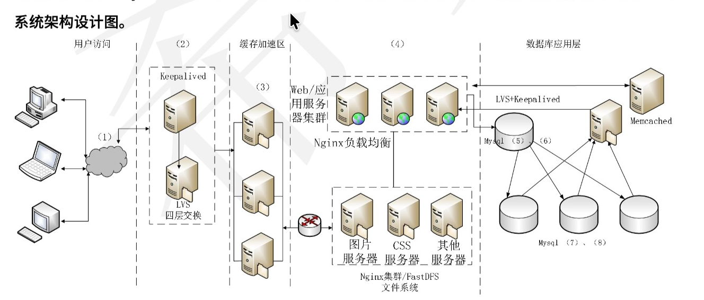

# 软考高项易错知识点

## 基础知识

- 专利

1. "专利三兄弟，申请日起算：发明 20、实用新型 10、外观 15；商标 10 年无限续展；著作权自然人终身+50，法人 50 年。"
2. "一般给单位'优先用'，特殊给单位'完全归'——软件是特殊，因为单位出钱出环境，代码归单位。"
3. 约定优先，无约定归受托方。
4. 国标三种：GB 强、GB/T 荐、GB/Z 导 —— 没有"商业性" 2. 能续展的只有商标（10 年×无限次）；专利发明/实用新型/外观 到点就死，不能续 3. 著作权"创作完成即产生"，登记≠产生，只是证明 4. 商业秘密"保密就永久"，可口可乐配方 100 年没人告它到期
  - GB：强制性国家标准
  - GB/T：推荐性国家标准
  - GB/Z：国家标准化指导性技术文件

- UML 图

1. RUP 四阶段（按顺序背）：初始（Inception）→ 精化（Elaboration）→ 构建（Construction）→ 移交（Transition） 记忆钩子：> "初精构移——'初'定范围、'精'建架构基线、'构'写完功能、'移'交付上线"
2. "精化"是 RUP 最关键的一步（建立可执行架构基线、识别主要风险）
3. RUP 四阶段 (是初始、精化、构建、移交)
"初精构移" —— 初定范围、精建基线(架构基线/主要风险)、构写功能、移交上
1. "CMMI 五级阶梯：初管定量化优——初始、已管理、已定义、量化管理、优化。老 CMM 才叫'可重复'，新版已改名。"
   已管理：项目级管好自己的需求/计划/监控（每项目各自为政）
   已定义：组织级统一标准过程，项目按标准裁剪执行 ← 组织级/统一/裁剪
   量化：用数据统计控制过程（SPC）
   优化：持续改进、缺陷预防 记忆钩子：> "2 管自己项目，3 统一全公司，4 拿数据说话，5 持续改进。"
   项目级=2，组织级=3，数据级=4，改进级=5

2. "UML 2.x = 14 = 7+7（7 结构图 + 7 行为图）。看到 9 种 → 那是老版 1.x。
3. 实心菱形 = '焊死'了（组合，同生共死）；空心菱形 = '松套'着（聚合，可拆开）。想象：实心=胶水粘死，空心=螺丝拧上。
4. 关系强度排序：依赖(最弱) < 关联 < 聚合(空心) < 组合(实心最强)。依赖是'借来用一下'，组合是'命绑一起'。

## 关系代数基本运算：

运算|	作用
--|--
选择 σ|	按条件选出元组，即筛选行
投影 π|	选出指定属性列
连接 ⋈|	按条件把两个关系组合起来
除法 ÷|	常用于“包含全部”类查询

- ATMA

1. 权衡点：一个决策，同时影响两个及以上质量属性，一升一降。
   1. 决策 2：并发能力↑ 但一致性风险↑ → 权衡点；
   2. 决策 3：查询能力↑ 但一致性↓（延迟不一致）→ 权衡点。
    风险点：架构决策中"可能引发问题"的、尚未验证的点（描述里通常有"可能"）。
    敏感点：对某质量属性敏感的决策点（单独影响一个属性）。
2. 要写一个"每秒处理 8000 笔交易"的可量化质量属性场景；
  标准写法（记这个模板）：
    刺激源：网银/柜台渠道（发起者）
    刺激：每秒 8000 笔交易请求
    环境：交易高峰时段（9:00–11:00）
    制品：核心交易系统
    响应：2 秒内完成处理并返回
    响应度量：平均响应时间 ≤ 2 秒 / 吞吐 ≥ 8000 TPS
  "六元组 = 谁（源）+ 用啥（刺激）+ 在哪（环境）+ 打谁（制品）+ 啥反应（响应）+ 多少算好（度量）"

- 可靠性指标

1. 自顶向下的短板恰恰是"关键计算模块在底层、最后才被测到"

2. "MTTF=平均无故障运行时间（活多久才坏）、MTTR=平均修复时间（坏多久才修好）、MTBF=平均故障间隔=MTTF+MTTR。可用性 A=MTTF/(MTTF+MTTR)。99.99%（四个 9）= 年宕机 52.6 分钟——这是案例/论文常考数据。

3. 维护占比排序	完善(50)>适应(25)>改正(20)>预防(5) <i>改 bug 天天有，预防性重构不常有 → 改正>预防<i>

- 其他

1. 死锁四条件：互斥 + 占有且等待 + 不可抢占 + 循环等待
2. 资源有序分配破坏循环等待

** 英语词记

1. 云四大件按需供给：provision（按需给资源） ← 你对了 2. 弹性 = elasticity：自动加/减资源，负载变化 → 扩缩容（virtualization 是虚拟化技术，不是伸缩能力） 3. upfront = 前期一次性：pay-as-you-go 降低的是 upfront cost（注意原文开头就有 "purchasing hardware upfront"，这是呼应线索——没读回去） 4. data privacy = 数据隐私：和 regulatory compliance（合规）、vendor lock-in（锁定）并列的是"隐私担忧" 5. orchestration = 编排：Kubernetes 的标准定语就是 container orchestration（管理部署/调度/自愈）
2. monolithic 微服务对立面 = 单体，independently 独立开发部署伸缩，consistency Saga/TCC → 数据一致性， mesh	ervice discovery/lb/熔断 = 服务网格， complexity 运营复杂性
3. 

** 案例分析

- 高并发架构
高并发架构图补充：根据系统架构图，关键的组件位置如下：

(1) CDN内容分发：加速静态资源传输。
(2) 负载均衡层：分发用户请求。
(3) 缓存服务器集群：缓存热点数据，减轻后端压力。
(4) Web应用层：执行业务逻辑。
(5) & (6) 主数据库 & 写操作：处理数据写入。
(7) & (8) 从数据库 & 读操作：处理数据读取。

主从复制机制的好处：

提升性能：一主多从，读操作分散到多个从库，提高并发处理能力。
可扩展性：访问量增加时，可快速增加从服务器。
提升可用性：单个从服务器故障不影响整体服务。
负载均衡：分担任务，减轻主库压力。
数据安全性：通过数据冗余备份，防止数据丢失。

- REDIS 缓存

1. 缓存穿透问题：大量不存在的key被查询，导致数据库压力过大。

空值方案的问题：为所有不存在的key设置空值，会无限消耗内存资源，导致性能急剧下降。
解决思路：在查询缓存前，先对key进行过滤（例如使用布隆过滤器），只允许系统中存在的key进行后续操作。

2. 缓存雪崩问题：大量key在同一时间失效，导致数据库瞬间压力爆增。

解决思路：
    加锁/队列：缓存失效后，通过排它锁或队列控制并发更新缓存的线程数量，使其串行化。
    设置随机失效时间：为不同key设置随机的失效时间，避免集中失效。
    设置多级缓存：使用多级缓存（如本地缓存 + 分布式缓存），即使一级缓存失效，还有二级缓存，避免直接访问数据库。

**分布式锁实现特点**
ZooKeeper: 临时顺序节点 + Watcher，天然适合分布式协调
Redis: 常用 SETNX、过期时间、Lua 脚本、Redlock 等实现

| 方案 | 实现步骤 | 一致性 |
|---|---|---|
| 2PC | 1. 协调者问所有参与者“能不能提交”；2. 参与者执行并锁定资源，返回准备结果；3. 全部成功则协调者下发提交，任一失败则全局回滚 | 强一致 |
| TCC | 1. Try 预留资源；2. 全部 Try 成功则 Confirm 确认提交；3. 任一失败则 Cancel 释放资源 | 最终一致 |
| SAGA | 1. 按顺序执行多个本地事务；2. 某一步失败；3. 按相反顺序执行补偿操作回滚 | 最终一致 |
| 本地消息表 | 1. 本地事务中同时写业务数据和消息表；2. 定时任务扫描消息表投递到 MQ；3. 消费者处理下游业务，失败重试，成功更新状态 | 最终一致 |

**2PC 强一致，TCC 预锁最终，SAGA 补偿最终，消息表异步最终。**

- **Transactional Outbox** 用于解决：业务数据写入数据库与发送消息之间的原子性问题。
- **CDC**（Change Data Capture）通过捕获数据库变更日志，把数据变更发布为事件，常用于数据同步和事件驱动架构。

- 架构分析

| 风格 | 核心特征 | 经典案例 |
| ------------- |:-------------:| -------------:|
|仓库|中央数据结构 + 多组件共享	|数据库、黑|板、编译器符号表|
|数据流	|数据顺序流经处理单元	|管道-过滤器、批处理|
|调用返回	|主控调用子程序	|主程序-子程序、面向对象、分层|
|独立构件	|进程间通信、事件驱动	|事件驱动、发布订阅|

1. 仓库 = 大家共用一个'仓库'（数据库/黑板/符号表）；管道 = 数据在'流水线'上流。

## 关键路径

关键路径是项目中**最长的路径**，决定了项目**最短工期**。
关键路径上的活动**没有机动时间**，因此总浮动时间 = **0**

- **自由浮动时间**：不影响紧后活动最早开始时间的机动时间。
- **总浮动时间**：不影响整个项目总工期的机动时间。
- **提前量**：紧后活动可以提前开始的时间，不是浮动时间。

## 文件存储

| 类型 | 全称 | 一句话定义 |
|---|---|---|
| DAS | Direct Attached Storage，直连式存储 | 存储设备通过 SCSI/SAS/光纤等接口直接连到一台服务器，像本地硬盘一样使用 |
| NAS | Network Attached Storage，网络附加存储 | 存储设备挂在普通以太网上，通过 NFS/SMB 等提供文件级共享 |
| SAN | Storage Area Network，存储区域网络 | 用光纤通道或 iSCSI 建专用存储网络，向服务器提供块级存储 |
RAID 1 |镜像存储| 数据具有冗余
对象存储||海量非结构化数据，通常通过 HTTP/REST 

NAS 提供文件级访问，SAN 提供块级访问；DAS 最简单但通常不能跨服务器共享。

## 令牌桶 vs 漏桶

算法|	核心特点
--|--
漏桶|	请求先进入桶中，以恒定速率流出；突发流量会被缓冲或丢弃
令牌桶|	按固定速率生成令牌，请求拿到令牌才能通过；桶中积累的令牌允许一定程度的突发流量

## E-R 图常见符号：

符号|	含义
--|--
矩形|	实体
椭圆|	属性
菱形|	联系
下划线|	主键属性

**方实、椭属、菱联、下划主。**

## 数据库设计阶段：

**需求**分析：收集用户需求。
**概念**设计：形成 E-R 图等概念模型。
**逻辑**设计：将 E-R 图转换为关系模式。
**物理**设计：确定存储结构、索引等。

**需求要什么，概念画E-R，逻辑转关系，物理定存储。**

| 模式 | 别名 | 含义 |
|---|---|---|
| 外模式 | 用户模式、子模式 | 用户看到的那部分数据视图 |
| 模式 | 概念模式、逻辑模式 | 数据库全体数据的全局逻辑结构 |
| 内模式 | 存储模式、物理模式 | 数据在存储介质上的物理存储方式 |

**外看用户，中看全局，内看存储。**

